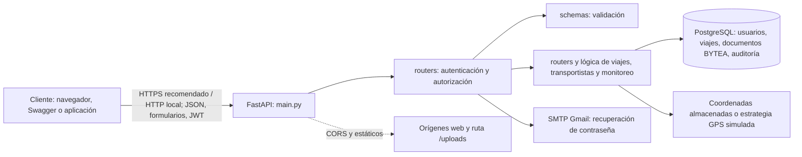

# Análisis de amenazas, vulnerabilidades y riesgos

**Parcial 1 · Actividad 1 · TransControl API**

> Informe académico de revisión estática y comprobación local limitada de configuración. No se modificó el código de la aplicación ni se ejecutaron pruebas contra sistemas desplegados. E1/E2 dinámicas siguen pendientes; los pasos propuestos deben ejecutarse únicamente en una base local aislada y con datos sintéticos.

## 1. Datos del análisis y alcance

| Dato | Registro |
| --- | --- |
| Aplicación | TransControl API, gestión de transportistas, viajes, documentos y monitoreo |
| Repositorio | `alexnacato/TransControl-Api` |
| Rama y commit base | `main`, `b3d024bceb2786a53c8adf2b6dfd6168d3716b27` |
| Fecha del análisis | 20 de octubre de 2026 |
| Alcance | Código de la API, configuración, modelos, autenticación, rutas de viajes y transportistas, y documentación del repositorio |
| Fuera de alcance | Infraestructura/PostgreSQL desplegados o de producción, credenciales externas, SMTP real, pruebas de penetración y evaluación de dependencias |
| Tipo de evidencia | Revisión manual del código; comprobación local de configuración JWT sin imprimir secretos; E1/E2 dinámicas pendientes |
| Herramientas registradas | Python 3.13.16 en `.venv`; FastAPI 0.115.6, SQLAlchemy 2.0.36, Psycopg 3.3.3, python-jose 3.3.0, Passlib 1.7.4, Pydantic 2.10.5 y pydantic-settings 2.7.1; Git 2.56.0.windows.2; ripgrep 15.0.0 |

Las versiones anteriores se consultaron en el entorno virtual del proyecto. Para reproducirlas desde la raíz:

```powershell
git rev-parse HEAD
git status --short
.\.venv\Scripts\python.exe --version
.\.venv\Scripts\python.exe -m pip freeze
git --version
rg --version
```

Las dependencias declaradas están fijadas en [requirements.txt](./requirements.txt), entre ellas FastAPI 0.115.6, SQLAlchemy 2.0.36, Pydantic 2.10.5 y python-jose 3.3.0. Se verificaron esas versiones en el `.venv` de este equipo; no se verificaron las versiones del entorno de despliegue.

## 2. Funcionalidad, roles y datos

TransControl ofrece inicio de sesión mediante correo o cédula, registro y recuperación de contraseña; administra usuarios, transportistas, vehículos y documentos PDF; crea, asigna y actualiza viajes; y consulta el estado y las coordenadas reales o simuladas de viajes. El acceso autenticado usa tokens JWT y dependencias de autorización por rol.

Los roles definidos en [models/models.py](./models/models.py) son `GERENTE`, `SECRETARIA`, `COORDINADOR`, `TRANSPORTISTA` y `PRESIDENTE`. En términos funcionales, la API restringe operaciones administrativas por rol (por ejemplo, revisión documental y asignación de viajes), mientras que los transportistas pueden consultar o subir ciertos datos propios. La revisión confirma restricciones específicas en algunas rutas, no una política de autorización completa para toda la aplicación.

**Activos principales**

| ID | Activo | Valor y motivo de protección |
| --- | --- | --- |
| A1 | Cuentas, contraseñas hasheadas, roles y tokens | Controlan la identidad y los permisos; una cuenta administrativa puede modificar operaciones importantes. |
| A2 | Documentos PDF de transportistas | Pueden contener cédulas, licencias, matrículas y otra información personal. |
| A3 | Información de usuarios y transportistas | Incluye nombres, cédula, correo, teléfono, dirección y datos del vehículo. |
| A4 | Viajes y carga | Incluye origen, destino, ruta, mercancía, peso, contenedor, contactos y calendario. |
| A5 | Ubicación GPS y estado de viajes | Puede revelar movimientos, ubicación y actividad de transportistas y carga. |
| A6 | Base PostgreSQL y disponibilidad de la API | Almacenan los activos anteriores y soportan las operaciones del negocio. |
| A7 | Registros de auditoría y configuración secreta | Permiten investigar acciones; la clave JWT y las credenciales de servicios deben permanecer confidenciales. |

## 3. Arquitectura y límites de confianza



**Flujo:** una solicitud llega a FastAPI, que la dirige a un router. Las rutas validan datos mediante esquemas, obtienen una sesión SQLAlchemy y, cuando se requiere, verifican JWT y rol. Las operaciones leen o escriben PostgreSQL. La recuperación de contraseña depende de SMTP; el monitoreo obtiene coordenadas guardadas o las simula. No se identificó en el código revisado una integración activa con un proveedor GPS externo: el adaptador y las estrategias son locales.

**Límites de confianza relevantes**

1. Cliente/red → API: los parámetros, el token y los archivos recibidos no son confiables hasta validarlos. CORS no sustituye autenticación ni autorización.
2. API → PostgreSQL: la API accede a datos personales y documentos; la URL y credenciales de conexión deben protegerse.
3. API → SMTP: el envío depende de un servicio externo. Un fallo de correo puede afectar recuperación de cuentas.
4. Rol/identidad → objeto solicitado: autenticar al usuario no prueba que tenga permiso sobre cualquier viaje o documento identificado por un ID.
5. Configuración de desarrollo → despliegue: valores por defecto y cuentas de demostración no deben asumirse seguros en producción.

## 4. Método y criterio de evidencia

Se revisaron rutas y esquemas relacionados con autenticación, permisos, viajes, documentos y carga de archivos; la configuración JWT/CORS; la inicialización de usuarios; y los modelos de datos. Las afirmaciones **confirmadas por revisión estática** señalan una secuencia o control visible en el código y su referencia reproducible. No implican que se haya probado el comportamiento en un despliegue real. Los elementos marcados **hipótesis pendiente** requieren validación adicional de configuración, cliente o entorno.

La evidencia se puede localizar con `rg -n "texto" archivo` desde la raíz del repositorio y contrastar abriendo el rango indicado. Ejemplo:

```powershell
rg -n "rol: str|rol=body.rol|@router.post\(\"/registro\"" schemas/auth_schemas.py routers/auth.py
rg -n "SECRET_KEY|jwt.encode|Admin1234!" core/config.py core/security.py main.py
```

No se reporta un escaneo automatizado como hallazgo confirmado. No se inició el servidor ni se enviaron solicitudes HTTP. Se hizo únicamente una consulta de solo lectura al PostgreSQL configurado: `current_database()` devolvió `transcontrol` y el recuento fue de 11 filas en `usuarios`. No se leyeron perfiles ni se modificaron registros. Por ello, esa base no se considera vacía y no se usa para E1/E2.

## 5. Matriz priorizada de riesgos

Escala: probabilidad e impacto de 1 (bajo) a 5 (muy alto). **Riesgo = P × I**. Rangos: bajo 1–4; medio 5–9; alto 10–16; crítico 17–25. Las puntuaciones son estimaciones iniciales para la aplicación descrita; deben recalibrarse con exposición, controles y datos reales.

| ID | Activo | Amenaza | Vulnerabilidad / debilidad | Evidencia | P | I | Riesgo | Control, prioridad y prueba de aceptación |
| --- | --- | --- | --- | --- | ---: | ---: | --- | --- |
| R1 | A1 cuentas y privilegios | Una persona sin cuenta obtiene funciones administrativas registrándose con un rol privilegiado. | **Confirmada por código.** El registro no exige usuario autenticado; el esquema acepta `rol` como texto y el endpoint asigna directamente el rol recibido. | `routers/auth.py:130–151`; `schemas/auth_schemas.py:43–46`; roles permitidos en `models/models.py:17–22`. | 4 | 5 | **20 crítico** | **P0 · Responsable: desarrollo/backend.** Forzar registro público a `TRANSPORTISTA`; validar rol con enum y reservar asignación de roles altos a una ruta administrativa autenticada. **Aceptación:** en BD de prueba, registro público con `GERENTE` devuelve 4xx y no crea usuario; registro permitido crea un usuario transportista; un administrativo autorizado puede asignar roles según política. |
| R2 | A1 cuentas privilegiadas | Un tercero inicia sesión con credenciales de demostración conocidas. | **Confirmada por código/documentación.** En arranque se crean cuentas de varios roles con la contraseña literal `Admin1234!`; el README también publica esas credenciales. | `main.py:64–149`; `README.md:232–242`. | 4 | 5 | **20 crítico** | **P0 · Responsable: backend/operaciones.** Eliminar cuentas predeterminadas en producción o exigir secretos únicos de aprovisionamiento, cambio de contraseña obligatorio y configuración segura. **Aceptación:** el arranque de producción no crea cuentas con contraseña conocida; en un entorno limpio, el login con credenciales de demostración falla y la cuenta inicial se crea mediante mecanismo seguro documentado. |
| R3 | A1 tokens y A7 secreto | Un atacante que conoce la clave por defecto puede falsificar tokens si el despliegue no la reemplaza. | **Confirmada como configuración insegura por defecto; exposición de un despliegue concreto pendiente.** La clave de firma tiene valor por defecto en código y se usa directamente al emitir JWT. No se valida que producción la haya cambiado. | `core/config.py:9–11`; `core/security.py:29–35`. | 3 | 5 | **15 alto** | **P1 · Responsable: backend/operaciones.** Requerir `SECRET_KEY` fuerte mediante variable/gestor de secretos y abortar inicio de producción si falta o coincide con el valor de desarrollo. **Aceptación:** pruebas de configuración rechazan ausencia y clave conocida en modo producción; tokens válidos se verifican solo con el secreto configurado y dejan de validarse al rotarlo. |
| R4 | A2 documentos y A4 viajes | Un usuario autenticado consulta información de objetos ajenos adivinando o conociendo sus identificadores. | **Confirmada por código para falta de autorización por objeto.** Descargar documentos y consultar un viaje requieren usuario autenticado, pero la ruta busca por ID y no comprueba pertenencia o permiso específico del objeto. | `routers/transportistas.py:482–506`; `routers/viajes.py:218–227`. | 4 | 4 | **16 alto** | **P1 · Responsable: backend.** Aplicar autorización por objeto y rol antes de devolver PDF o datos de viaje; limitar transportistas a sus propios registros, salvo roles con necesidad funcional. **Aceptación:** token de transportista A no obtiene PDF ni detalle del viaje de B (403/404 conforme a política); roles autorizados sí acceden; las pruebas cubren identificadores ajenos y propios. |
| R5 | A6 disponibilidad y A2 documentos | Una carga de archivo grande consume memoria o recursos de la API. | **Hipótesis pendiente de impacto dinámico.** La ruta lee todo el archivo en memoria y solo después compara el tamaño con el máximo. No hay evidencia aquí de límites en proxy/servidor que eliminen el riesgo. | `routers/transportistas.py:312–343`; límite configurado en `core/config.py:18`. | 3 | 4 | **12 alto** | **P1 · Responsable: backend/operaciones.** Limitar tamaño durante la lectura/recepción, rechazar solicitudes grandes en servidor/proxy y mantener límites de concurrencia. **Aceptación:** archivo por encima del límite se rechaza sin acumular el contenido completo en memoria; archivo PDF válido bajo el límite se guarda y se puede descargar íntegro; medir memoria con carga controlada en laboratorio. |
| R6 | A1 cuentas y A6 disponibilidad | Una solicitud de recuperación deja a una persona sin poder usar su contraseña anterior si falla el correo. | **Confirmada la secuencia de fallo en código; frecuencia del fallo SMTP pendiente.** La contraseña nueva se guarda y confirma antes del envío; un error posterior devuelve 500 sin restaurar la anterior. | `routers/auth.py:159–185`, especialmente `174–182`. | 3 | 3 | **9 medio** | **P2 · Responsable: backend.** Usar un token de restablecimiento temporal de un solo uso, con expiración, y cambiar la contraseña únicamente después de validar el token; no enviar contraseñas en texto claro. **Aceptación:** si SMTP falla, la contraseña existente sigue funcionando; un token válido permite cambiarla una vez, y token expirado/reutilizado se rechaza. |
| R7 | A1 tokens y A3/A4 datos | Un sitio web de tercero intenta leer respuestas autenticadas de la API desde un navegador. | **Hipótesis pendiente de validación.** CORS permite cualquier origen, credenciales, métodos y encabezados. El impacto depende del cliente, tipo de credencial y comportamiento efectivo del navegador/middleware; CORS por sí solo no entrega un token bearer. | `main.py:29–35`. | 2 | 3 | **6 medio** | **P2 · Responsable: backend/frontend.** Restringir orígenes, métodos y encabezados a los necesarios; revisar cómo se almacena y envía la credencial en el cliente. **Aceptación:** origen autorizado recibe CORS esperado; origen no autorizado no puede leer respuestas desde navegador; pruebas no confunden una petición HTTP directa con una lectura permitida por CORS. |

### Consecuencias por escenario

La amenaza describe quién o qué podría causar el evento; la debilidad identifica la condición técnica que lo facilita; la consecuencia es el daño si el escenario se concreta:

- **R1:** una cuenta con rol superior al que corresponde puede acceder a operaciones administrativas y alterar usuarios, viajes o decisiones operativas.
- **R2:** quien use una contraseña de demostración publicada puede suplantar personal y acceder a las funciones habilitadas para esa cuenta.
- **R3:** si el secreto conocido está activo en producción, se podrían fabricar tokens que la API acepte como válidos, comprometiendo cuentas y permisos.
- **R4:** un usuario podría obtener PDF y datos de viajes de otras personas, exponiendo documentos de identidad y datos de ubicación, carga o contacto.
- **R5:** las cargas grandes podrían elevar el consumo de memoria y degradar o interrumpir la disponibilidad; el impacto debe medirse en laboratorio.
- **R6:** si falla el correo después del cambio persistido, la persona no conoce la nueva contraseña y puede quedar sin acceso a su cuenta.
- **R7:** si el navegador envía credenciales de forma compatible con el escenario, un origen no confiable podría leer datos de respuestas privadas; esa condición todavía no se ha comprobado.

### Justificación de puntuaciones

- **R1 y R2:** la explotación requiere acceso a la API o su registro público, condición normal si el servicio se publica; el impacto potencial es control administrativo o uso de una cuenta con privilegios, por eso P4/I5 y crítico.
- **R3:** el defecto está en el valor por defecto, pero el despliegue puede sobrescribirlo mediante entorno; por eso P3, con impacto I5 si la clave conocida queda activa.
- **R4:** requiere autenticación, pero el control por objeto está ausente en las rutas revisadas y los datos incluyen información personal y comercial; se estima P4/I4.
- **R5:** el consumo de recursos y el tamaño máximo efectivo dependen del stack de despliegue; la lectura previa al chequeo justifica investigar, no afirmar una denegación de servicio demostrada.
- **R6:** el fallo exige que el correo no se envíe después del commit; la consecuencia sería bloqueo de cuenta y soporte manual, normalmente acotado a la persona afectada.
- **R7:** la amplitud de CORS es verificable, pero no se demuestra por sí sola el robo de datos; por eso se conserva como hipótesis media y requiere probar el cliente y navegador utilizados.

## 6. Procedimiento seguro y reproducible para evidenciar tres debilidades

Los tres primeros ejercicios son comprobaciones controladas de laboratorio; usar únicamente una copia local, base de datos desechable y datos sintéticos. No enviar estas solicitudes a una instancia de producción o de terceros.

### E1. Registro con rol privilegiado (R1)

**Evidencia estática:** revisar el esquema `UsuarioCreate` y la función `registrar`: el campo `rol` es texto, `/registro` no declara dependencia de autenticación y el valor se asigna al usuario creado.

**Validación dinámica opcional:** con la API local y una base limpia aislada, enviar a `POST /api/auth/registro` un JSON sintético válido con `rol: "GERENTE"`; comprobar el código de respuesta y consultar la fila creada en esa base. Si se obtiene 201 y el rol queda como gerente, queda reproducida la asignación. No reutilizar cédulas, correos ni contraseñas reales.

### E2. Cuentas predeterminadas (R2)

**Evidencia estática:** localizar la creación de gerente y cuentas de prueba en `main.py`; comparar correo/contraseña con la tabla de cuentas de demostración del README.

**Validación dinámica opcional:** en una BD local recién inicializada, permitir el arranque y consultar únicamente esa BD; verificar si las cuentas aparecen. Se puede comprobar el login de una cuenta de laboratorio contra `POST /api/auth/login`. Registrar respuesta y entorno, nunca copiar tokens al informe. No probar credenciales contra host público alguno.

### E3. Clave JWT por defecto (R3)

**Evidencia estática:** comprobar el valor por defecto de `SECRET_KEY` en `core/config.py` y que `create_access_token` lo pasa a `jwt.encode` en `core/security.py`.

**Validación dinámica realizada (20 de octubre de 2026):** en un proceso local aislado, se creó `Settings(_env_file=None)` tras retirar `SECRET_KEY` del entorno del proceso. Se comparó el valor resultante con el literal de desarrollo y se imprimió únicamente `default_without_env=True/False`; el resultado fue `True`. Luego se pasó una clave ficticia de laboratorio y solo se imprimió `env_override_applied=True/False`; el resultado fue `True`. No se mostró ni registró ninguna clave, no se creó un JWT y no se probó un despliegue. Esta prueba confirma el valor predeterminado de la configuración Python, no qué clave utiliza un servidor remoto.

Para repetirla y capturar únicamente los resultados booleanos desde la raíz del repositorio:

```powershell
@'
import os, sys, tempfile
from pathlib import Path

root = str(Path.cwd())
os.environ.pop("SECRET_KEY", None)
os.environ.pop("DATABASE_URL", None)
with tempfile.TemporaryDirectory() as tmp:
    os.chdir(tmp)
    try:
        sys.path.insert(0, root)
        from core.config import Settings
        expected = "CAMBIA_ESTA_CLAVE_EN_PRODUCCION_debe_tener_64_chars_minimo"
        print("default_without_env =", Settings(_env_file=None).SECRET_KEY == expected)
        lab_key = "solo-una-clave-ficticia-para-la-prueba"
        print("env_override_applied =", Settings(_env_file=None, SECRET_KEY=lab_key).SECRET_KEY == lab_key)
    finally:
        os.chdir(root)
'@ | .\.venv\Scripts\python.exe -
```

La salida esperada es `True` en ambos casos. El programa no imprime la clave real ni genera tokens. Para la captura, muestra solo este resultado y no abras ni captures `.env`.

**Evidencia pendiente:** E1 y E2 están confirmados por revisión estática, pero su prueba dinámica no se ejecutó. Aunque inicialmente se consideró vacía, la base local configurada tiene 11 usuarios; no se asumió que fueran sintéticos ni se tocó esa información. Para completar las figuras dinámicas de E1/E2, preparar una base nueva y aislada como se indica abajo. E3 sí cuenta con verificación local de configuración, cuyos resultados booleanos pueden capturarse repitiendo el procedimiento.

### Preparación segura y comandos de laboratorio (E1/E2)

1. En pgAdmin, conectado al PostgreSQL local, crea una base vacía llamada `transcontrol_risk_lab`. No uses `transcontrol` ni una base compartida. No incluyas credenciales reales en capturas o en el informe.
2. En un archivo temporal fuera del repositorio (por ejemplo, `%TEMP%\transcontrol-risk-lab.env`), define `DATABASE_URL` con el mismo usuario y contraseña de tu conexión local, host `localhost`, puerto `5432` y base `transcontrol_risk_lab`. Define una `SECRET_KEY` temporal aleatoria para el servidor de prueba y deja `SMTP_USER`/`SMTP_PASS` vacíos. No subas ese archivo al repositorio.
3. Desde la raíz del proyecto, inicia la API en loopback y un puerto libre, pasando el archivo temporal a Uvicorn:

```powershell
.\.venv\Scripts\python.exe -m uvicorn main:app --host 127.0.0.1 --port 18765 --env-file "$env:TEMP\transcontrol-risk-lab.env"
```

El arranque ejecuta `create_tables()` e inicializa cuentas de demostración en esa base; por eso es esencial apuntar al nombre nuevo. La consola puede imprimir las credenciales de demostración definidas en `main.py`: no compartas una captura de esos logs.

4. Abre otra ventana de PowerShell y ejecuta E1 con datos sintéticos. El ID y correo de prueba son únicos por ejecución:

```powershell
$testId = Get-Date -Format 'yyyyMMddHHmmss'
$payload = @{
    cedula = '99' + $testId.Substring($testId.Length - 8)
    nombres = 'Prueba E1 Laboratorio'
    correo = "e1-$testId@example.com"
    password = 'Lab-Only-E1-2026!'
    rol = 'GERENTE'
} | ConvertTo-Json

$respuesta = Invoke-WebRequest -UseBasicParsing `
    -Uri 'http://127.0.0.1:18765/api/auth/registro' `
    -Method Post -ContentType 'application/json' -Body $payload
$respuesta.StatusCode
$respuesta.Content | ConvertFrom-Json | Select-Object id, cedula, nombres, correo, rol
```

La evidencia debe mostrar estado HTTP `201` y `rol = GERENTE`. En pgAdmin, conectado a `transcontrol_risk_lab`, consulta la fila por el correo sintético devuelto:

```sql
SELECT id, cedula, nombres, correo, rol
FROM usuarios
WHERE correo = 'COPIAR_AQUI_EL_CORREO_SINTETICO_DEVUELTO';
```

No consultes `hashed_password`. Captura la respuesta filtrada de PowerShell y la fila de pgAdmin. El correo, nombre y cédula son datos sintéticos; confirma que no se reutilicen datos reales.

5. Para E2, en esa misma base recién inicializada, verifica la cuenta de demostración con la información publicada en el README. No imprimas el token: asigna la respuesta a una variable y muestra solo los campos permitidos.

```powershell
$loginBody = @{
    username = 'admin@transcontrol.ec'
    password = 'CONSULTAR_CREDENCIAL_DEMO_EN_README'
} | ConvertTo-Json
$login = Invoke-RestMethod `
    -Uri 'http://127.0.0.1:18765/api/auth/login' `
    -Method Post -ContentType 'application/json' -Body $loginBody
$login | Select-Object id, nombres, rol, token_type
```

Reemplaza el marcador de contraseña localmente usando la credencial documentada para el laboratorio; no pegues el valor en el informe, una captura ni este chat. En pgAdmin puedes comprobar únicamente correo y rol:

```sql
SELECT correo, rol
FROM usuarios
WHERE correo = 'admin@transcontrol.ec';
```

No selecciones ni captures `access_token` o `hashed_password`. Esta validación acredita el comportamiento de arranque y login de la copia local, no una cuenta en un servicio remoto.

6. Al terminar, detén Uvicorn con `Ctrl+C`. Conserva la BD de laboratorio solo el tiempo necesario para documentar; elimínala desde pgAdmin únicamente si confirmas que es la base nueva dedicada a este ejercicio. Nunca borres ni limpies `transcontrol`.

### Procedimiento de capturas

En VS Code, abre el archivo indicado, activa números de línea y usa `Ctrl+G` para ir al rango. Captura el código junto con el nombre del archivo y los números de línea (`Win+Shift+S`); evita incluir archivos `.env`.

| Figura | Archivo o pantalla | Nombre sugerido |
| --- | --- | --- |
| 3(a) E1 estática | `routers/auth.py` líneas 130–151 y `schemas/auth_schemas.py` líneas 43–46. Usa dos capturas si no caben legiblemente en una. | `img/fig03a-e1-codigo.png` |
| 3(b) E1 dinámica | Respuesta filtrada de PowerShell con estado/rol y consulta de la fila sintética en pgAdmin. | `img/fig03b-e1-prueba.png` |
| 4(a) E2 estática | `main.py` líneas 64–149 y `README.md` líneas 232–242. No captures la consola de arranque que imprime credenciales. | `img/fig04a-e2-main-readme.png` |
| 4(b) E2 dinámica | Resultado del login local mostrando solo `id`, `nombres`, `rol`, `token_type`, junto con correo/rol de pgAdmin. Token oculto. | `img/fig04b-e2-login.png` |
| 5(a) E3 estática | `core/config.py` líneas 9–11 y `core/security.py` líneas 29–35. | `img/fig05a-e3-codigo.png` |
| 5(b) E3 dinámica | Salida booleana de la prueba sin entorno y con override ficticio; nunca la clave. | `img/fig05b-e3-config.png` |

Guarda capturas auténticas en `img/` y comprueba que sean legibles. No fabriques capturas ni edites respuestas. En los pies de figura indica fecha, base local de laboratorio, método (estático o dinámico) y que no se utilizaron datos reales.

## 7. Plan de controles antes de modificar código

Orden sugerido:

1. **P0 — cerrar asignación pública de roles privilegiados (R1) y retirar cuentas conocidas (R2).** Son controles de identidad con posible impacto administrativo; diseñar política de roles y aprovisionamiento antes de tocar el código.
2. **P1 — eliminar el secreto JWT por defecto en producción (R3), autorizar acceso por objeto (R4) y limitar cargas durante la lectura (R5).** Especificar configuraciones por entorno y casos de prueba negativos/positivos.
3. **P2 — rehacer recuperación de contraseña (R6) y restringir CORS (R7).** Verificar primero el flujo frontend y el canal de correo que se utilizará.
4. Registrar resultados, pruebas y versión/commit de cada cambio; volver a evaluar P e I después de aplicar controles. No considerar una advertencia del escáner como vulnerabilidad confirmada sin validación.

| Cambio esperado en el software | Prueba de aceptación resumida |
| --- | --- |
| Registro público solo crea el rol de menor privilegio permitido; cambio de rol separado y autorizado. | La API rechaza rol privilegiado en registro y las pruebas de autorización demuestran que no se asigna. |
| No crear usuarios de demostración con contraseñas públicas al desplegar. | Inicio limpio en modo producción sin cuentas conocidas; instalación local conserva un flujo de prueba explícito y aislado si se necesita. |
| Validación estricta de configuración de JWT en producción. | Arranque con secreto ausente o de desarrollo falla de forma explícita; token emitido valida con secreto correcto y falla al rotarlo. |
| Verificación de permisos sobre cada documento/viaje consultado. | Usuarios con rol/propietario distinto reciben denegación; usuario propietario y roles autorizados reciben acceso esperado. |
| Límite de carga aplicado mientras se procesa el flujo, además del máximo del proxy. | Archivo mayor al límite se rechaza tempranamente; tamaño de memoria se mantiene acotado en prueba controlada. |
| Recuperación con token temporal y de un solo uso, sin enviar la contraseña generada. | Fallo de SMTP no cambia la contraseña; token vencido o reutilizado es rechazado. |
| CORS de lista permitida según los orígenes reales del frontend. | Origen autorizado funciona; origen no autorizado no puede leer la respuesta en un navegador. |

## 8. Limitaciones y conclusión

Este análisis es una línea base del commit indicado y no sustituye pruebas dinámicas, revisión de infraestructura ni evaluación de dependencias. Se verificaron únicamente el host y el nombre de la base configurada, sin mostrar credenciales, y se contó el número de filas de `usuarios`; no se leyeron perfiles ni se alteraron datos. No se inspeccionaron secretos, SMTP ni despliegues. La presencia de un control en una ruta tampoco garantiza que todos los caminos del sistema respeten la misma política.

La prioridad inmediata para planificar el siguiente cambio es **R1, el registro que acepta el rol proporcionado por el cliente**, junto con **R2, las cuentas inicializadas con credenciales publicadas**. Antes de cambiar código, conviene acordar si el registro público debe permitir solo transportistas, cómo se crea el primer gerente y qué política rige el acceso de cada rol a viajes y documentos. Después se implementarán controles pequeños, se añadirán pruebas de aceptación para rutas permitidas y denegadas y se volverán a valorar los riesgos.

---

**Campos para completar antes de entregar:** nombre(s) del estudiante y curso/docente; después de ejecutar E1/E2 en la base aislada, registrar fecha, salida HTTP, fila sintética, resultado de login sin token y capturas auténticas. Las versiones del entorno local de este análisis ya están registradas arriba. Si se modifica el código, anotar además el commit posterior y las pruebas ejecutadas.

## 9. Lista de comprobación de la rúbrica

- [x] Describe funcionalidades, roles, arquitectura, datos sensibles y límites de confianza.
- [x] Incluye diagrama del flujo cliente–API–base de datos y dependencias relevantes.
- [x] Inventaría más de cinco activos y presenta siete escenarios diferenciados.
- [x] Distingue amenaza, debilidad concreta, consecuencia y evidencia.
- [x] Clasifica los hallazgos como confirmados por código o hipótesis pendiente.
- [x] Asigna probabilidad, impacto, producto de riesgo y nivel conforme a la escala indicada.
- [x] Justifica la valoración y ordena controles P0–P2.
- [x] Propone responsable, control y prueba de aceptación para cada riesgo.
- [x] Incluye referencias de código y pasos locales reproducibles para tres debilidades.
- [x] E3 tiene comprobación de configuración local, sin mostrar secretos.
- [ ] Antes de entregar: completar identidad/curso y ejecutar E1/E2 solo en una nueva base desechable; adjuntar sus resultados y capturas. Si se modifica el código, anotar el nuevo commit y validar los cambios.
